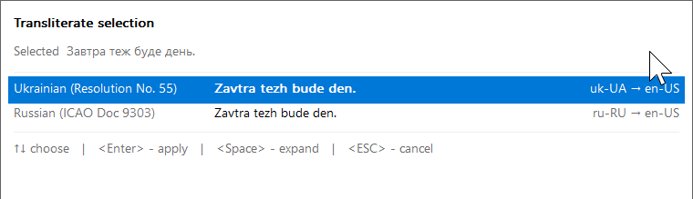

# LexiSwitch


**Fix text you typed under the wrong keyboard layout, change the case of anything you select,
and write Cyrillic in Latin letters — without leaving the keyboard.**

An offline tray utility for Windows 11. No account, no network, no installer.


---

## What it's for

Three small problems that cost a surprising amount of time.

**You typed in the wrong layout.** You meant to write Ukrainian, English was still active, and
what came out was `{jxe ltoj d nt,t pfgbnfnb/`. Retyping it is the usual answer. Select it,
press `Win+Shift+Pause`, press `Enter` — it becomes `Хочу дещо в тебе запитати.`

**You need the text in a different case.** A sentence has to become `snake_case` for a variable
name, a shouted line has to come down to lowercase, a heading needs Every Word Capitalized.
Select it, press `Win+Ctrl+Pause`, pick from the list.

**You need it in Latin letters.** A name for a form, a file name, an address abroad:
`Олексій Знам'янка` has to become `Oleksii Znamianka`, by the official rules rather than by
guesswork. Select it, press `Win+Alt+Pause`, press `Enter`.

All three work in whatever you happen to be writing in — an editor, a browser field, a chat
box — because they operate on the selection rather than on a document they had to open.

---

## Three modes, three shortcuts

They are deliberately separate. Any text can be re-cased, any Cyrillic text has both layout
candidates and transliterations, so one merged list would be mostly irrelevant every time.

### `Win+Shift+Pause` — fix the layout


Every pair of installed layouts is offered: what the text would be if you had meant to type it
in Ukrainian, in German, in English. Each row shows the result and how much of the text it would
leave unchanged, so the right one is usually obvious at a glance — a candidate that changes
almost nothing is almost certainly not what you meant.

`Ctrl+Enter` applies the conversion **and switches your typing layout** to the one it converted
to, which is normally the next thing you were going to do anyway.

### `Win+Ctrl+Pause` — change the case


Fifteen styles, always all of them, always in the same order: a style that would change nothing
is dimmed rather than dropped, so the row you are aiming for is where it was last time.

| Category         | Conversions                                                                                                                        |
|------------------|------------------------------------------------------------------------------------------------------------------------------------|
| **Plain**        | As typed · Invert case · lowercase · UPPERCASE                                                                                     |
| **Identifiers**  | camelCase · snake_case · dot.case · kebab-lowercase · PascalCase · SCREAMING_SNAKE_CASE · Capitalized_Snake_Case · KEBAB-UPPERCASE |
| **Prose**        | First word capitalized · Words Capitalized                                                                                         |
| **Abbreviation** | ABBR                                                                                                                               |

`ABBR` takes the first character of each word, uppercased, and keeps what is already
abbreviated: numbers and capitals stay whole. `First word capitalized` gives `FWC`,
`Windows 11` gives `W11`, `HTTPServer` gives `HTTPS`. Several words written entirely in capitals
are shortened word by word instead, so `SCREAMING_SNAKE_CASE` gives `SSC`. Any character that is
not a letter or a digit separates words, so `/opsx:archive` gives `OA`.

**Often used** at the top holds the three styles you apply most, so the ones you actually use
are a keystroke away. `Ctrl+R` forgets them and starts counting again.

The six numbered checkboxes strip things out before the style is applied — punctuation, digits,
spaces, line breaks. `1` through `6` toggle them.


Removing spaces does not destroy word boundaries: `Words Capitalized` with spaces removed gives
`HelloWorld`, not `Helloworld`. Each line keeps its own identity unless you ask for the lines to
be joined.

### `Win+Alt+Pause` — transliterate



One row per transliteration ruleset, each showing what the selection would become. Two are built
in:

| Ruleset                           | Standard                                                       | Example                                    |
|-----------------------------------|----------------------------------------------------------------|--------------------------------------------|
| **Ukrainian (Resolution No. 55)** | Cabinet of Ministers of Ukraine, 2010 — passports, place names | `Щедрий Знам'янка` → `Shchedryi Znamianka` |
| **russian (ICAO Doc 9303)**       | The passport scheme russia has used since 2014                 | `Щукин Ульяна` → `Shchukin Uliana`         |

The rules that make transliteration more than a letter-for-letter swap are handled: `зг` is
`zgh`, `я` is `ya` at the start of a word and `ia` inside one, the soft sign and the apostrophe
disappear, and capitals follow the text — `Щедрий` gives `Shchedryi`, `ЩУКА` gives `SHCHUKA`.
Latin letters, digits and punctuation pass through untouched. A row that would change nothing is
dimmed, and a row that left Cyrillic letters it does not know says how many.

**Your own rulesets** go in `%APPDATA%\LexiSwitch\transliteration\`, one TOML file each — tray
menu → **Open transliteration folder**. The release zip carries
`transliteration.example.toml`, the Ukrainian ruleset with every part of the format explained:

```toml
id     = "uk-kmu55"                 # the same id as a built-in replaces it
name   = "Ukrainian (Resolution No. 55)"
source = "uk-UA"
target = "en-US"

[map]                               # any length; the longest match wins
"зг" = "zgh"
"я"  = "ia"
"ь"  = ""                           # empty: dropped

[word_start]                        # used instead at the start of a word
"я" = "ya"
```

Changes are picked up within seconds. A file with a mistake is reported with its line, keeps its
last working version, and leaves every other ruleset working.

---

## What every window does

**Nothing is written until you press `Enter`.** Opening the window, moving through it, and
turning options on and off change nothing in your document. `Esc` leaves everything exactly as
it was.

**`Space` shows the whole result** when the one-line preview is too short to judge by. The part
that would change is highlighted.


**`Ctrl+C` copies a result without applying it.** Pick an option, copy it, press `Esc` — your
selection is untouched and the transformed text is on the clipboard, ready to paste somewhere
else. By default that copy is kept out of Windows Clipboard History; `H` lets it in for this one
copy.

---

## Getting started

**You need** Windows 11 and **at least two keyboard layouts installed** — with only one there is
nothing to convert between, and LexiSwitch says so and stops rather than sitting in the tray
doing nothing.

1. Run `lexiswitch.exe`. There is no installer and nothing is written outside `%APPDATA%`.
2. It goes to the notification area and tells you its shortcuts.
3. Select some text and press one of them.

To start it with Windows, put a shortcut to it in
`%APPDATA%\Microsoft\Windows\Start Menu\Programs\Startup`.

Only one copy runs at a time. Starting a second makes the first one announce itself instead.

### The tray icon

Right-click it for everything the program can do:


- **LexiSwitch** and a version number — the first line says which version is running. It is
  not a command. File Properties → Details shows the same without running it.
- **Convert selection**, **Change case…** and **Transliterate selection…** — the same three
  transactions, for when a shortcut is unavailable
- **Disable LexiSwitch** — the shortcuts stop converting until you enable it again
- **Change conversion shortcut…** / **Change case shortcut…** / **Change transliteration
  shortcut…** — press the combination you want
- **Diagnostics** — what state it is in and why
- **Reload configuration** / **Open configuration file** / **Open transliteration folder**
- **Quit**

The icon itself says which state it is in, without hovering for the tooltip:


"Needs attention" means a shortcut another program has taken, a shortcut left without a
combination, a configuration file or transliteration ruleset it refused to load, or too few
keyboard layouts to convert between. Which one it is, it tells you.

---

## Keys

| | Layout window | Case window | Transliteration window |
|---|---|---|---|
| Open | `Win+Shift+Pause` | `Win+Ctrl+Pause` | `Win+Alt+Pause` |
| Move | `↑` `↓` | `↑` `↓` `PgUp` `PgDn` `Home` `End` | `↑` `↓` `PgUp` `PgDn` `Home` `End` |
| Apply | `Enter` | `Enter` | `Enter` |
| Apply and switch typing layout | `Ctrl+Enter` | — | — |
| Show the whole result | `Space` | `Space` | `Space` |
| Strip options | — | `1`–`6` | — |
| Forget "Often used" | — | `Ctrl+R` | — |
| Copy without applying | `Ctrl+C` or `Ctrl+Ins` | `Ctrl+C` or `Ctrl+Ins` | `Ctrl+C` or `Ctrl+Ins` |
| Allow that copy into Clipboard History | `H` | `H` | `H` |
| Close, changing nothing | `Esc` | `Esc` | `Esc` |

---

## Settings

Everything is optional. Right-click the tray icon → **Open configuration file** and it creates a
commented example at `%APPDATA%\LexiSwitch\config.toml` on first use. Changes are picked up
without a restart.

```toml
[general]
enabled = true                        # whether the shortcuts convert

[hotkeys]
convert_selection = "Win+Shift+Pause"
change_case       = "Win+Ctrl+Pause"
transliterate     = "Win+Alt+Pause"   # left unset and already used by another shortcut you
                                      # set, it gives way: no shortcut, and the tray says so

[layouts]
candidates = []                       # e.g. ["uk-UA", "en-US"] to fix the order

[selection]
allow_clipboard_fallback = true       # read the selection via the clipboard where the
                                      # accessible-text route does not work

[chooser]
expanded_lines = 10                   # how tall the expanded view is

[logging]
enabled = false                       # event kinds and lengths only, never text
```

A configuration file that does not parse is **rejected whole**: the settings you were already
running stay in force, and the tray tells you which line it choked on. There is no half-applied
state to get stuck in.

Transliteration rulesets are the one other thing you configure, in their own folder rather than
in this file — see [above](#winaltpause--transliterate).

One other file is written, `%APPDATA%\LexiSwitch\state.toml`, and it holds only how many times
each case style has been used — style names and integers, nothing else. Delete it, or press
`Ctrl+R` in the case window, and the counting starts again.

---

## What it does not do

This matters more than a feature list, so it is stated as a property rather than a promise.

**It never watches you type.** There is no keystroke monitor of any kind — not a low-level hook,
not Raw Input, not anything. It has no idea what you are typing and no way to find out. It sees
exactly one thing: the text you selected, at the moment you pressed a shortcut, and only then.
(The earlier design did observe typing through an API that structurally cannot alter a
keystroke; that whole capability was removed rather than made safer.)

**It cannot reach the network.** There is no telemetry, no update check, no crash reporting, and
no code that could do any of them. The whole dependency tree is `serde`, `toml` and the Windows
API bindings; network-capable crates are banned by `cargo-deny` as part of the build, not as a
policy someone has to remember.

**Nothing you convert reaches disk.** Not the configuration, not the log, not a crash dump.
Logging is off by default and records event kinds and lengths (`converted_word len=7`), never
content.

**A password field is only ever at risk if you select one yourself.** There is no detection to
trust here and none is needed: the program reads what you selected, when you asked, and nothing
else. Earlier versions did detect password fields — that was there to protect a keystroke buffer
that no longer exists, and its coverage inside browsers was measurably poor, so the thing it
guarded was removed instead ([ADR-0011](docs/adr/0011-no-keyboard-observation.md)).

Under 1.3 MB, no runtime, no background service.

---

## Known limits

- **The clipboard is borrowed** when an application does not expose its selection through the
  accessible-text interface (most editors do; some do not). The previous contents are put back,
  but only text formats are restored — an image on the clipboard survives, a niche private
  format may not. Turn `allow_clipboard_fallback` off to forbid this entirely, at the cost of
  those applications.
- **Some applications hide their selection.** Where neither the accessible-text route nor the
  clipboard fallback can read it, LexiSwitch says the selection could not be read rather than
  guessing at one.
- **A modifier you are still physically holding** can occasionally swallow the keystrokes that
  apply the result — roughly one attempt in five in the worst-behaved applications. Release the
  shortcut before pressing `Enter`.

---

## Building it yourself

```powershell
cargo build --release        # target\release\lexiswitch.exe
cargo test --workspace
```

Rust 1.97 or newer, MSVC toolchain, and — for the full test suite — the `en-US`, `uk` and
`de-DE` keyboard layouts installed, because the layout tables are read from Windows rather than
shipped, and German is the only one of the three with dead keys.

[`docs/environment.md`](docs/environment.md) covers the rest of the setup.
[`docs/adr/`](docs/adr/README.md) records why the design is the way it is, including the
alternatives that were rejected; [`docs/manual-tests.md`](docs/manual-tests.md) records what has
actually been verified by hand, and what broke on the way.

## Known Issues

### ⚠️ [false-positive] Releases are flagged as malicious by a few VirusTotal scanners :)

A handful of antivirus engines flag every release, out of roughly seventy. The labels are
generic heuristics (`Trojan.Malware.300983.susgen`, plain `Malicious`) rather than a named
family: an unsigned executable that reads the selection and drives the clipboard looks
suspicious to a heuristic, whatever it actually does.

| Release | File                                           | Flagged by                                                                                                             | SHA-256                                                            |
|---------|------------------------------------------------|------------------------------------------------------------------------------------------------------------------------|--------------------------------------------------------------------|
| 0.2.0   | `lexiswitch.exe` / `lexiswitch-0.2.0.exe`      | [2/71](https://www.virustotal.com/gui/file/c788d63e41b327d73fbb696568a37e4476181d22c62dd4e302f2aa2deb23ed7c/detection) | `c788d63e41b327d73fbb696568a37e4476181d22c62dd4e302f2aa2deb23ed7c` |
| 0.2.0   | `lexiswitch-0.2.0-x86_64-pc-windows-msvc.zip`  | [1/68](https://www.virustotal.com/gui/file/15d2c168c5f793b312d72896bedb7709c1815efb7d9fc45a11a5cd033d6855d9/detection) | `15d2c168c5f793b312d72896bedb7709c1815efb7d9fc45a11a5cd033d6855d9` |
| 0.1.0   | `lexiswitch.exe`                               | [3/71](https://www.virustotal.com/gui/file/71d58e1dc3cfdea847720fc9d135202d33f032992b061903af41718c76c39a3a/detection) | `71d58e1dc3cfdea847720fc9d135202d33f032992b061903af41718c76c39a3a` |
| 0.1.0   | `lexiswitch-v0.1.0-x86_64-pc-windows-msvc.zip` | [1/67](https://www.virustotal.com/gui/file/e226f982751b750cb09e5a3c6fa30719783e10a69761edde3f6497c75824ca75/detection) | `e226f982751b750cb09e5a3c6fa30719783e10a69761edde3f6497c75824ca75` |

> 🟢 **Yep!**  
> This is why **open-source is good** – it allows anyone to inspect the code and verify what exactly it does, and ensure that it does not contain any malicious code.
